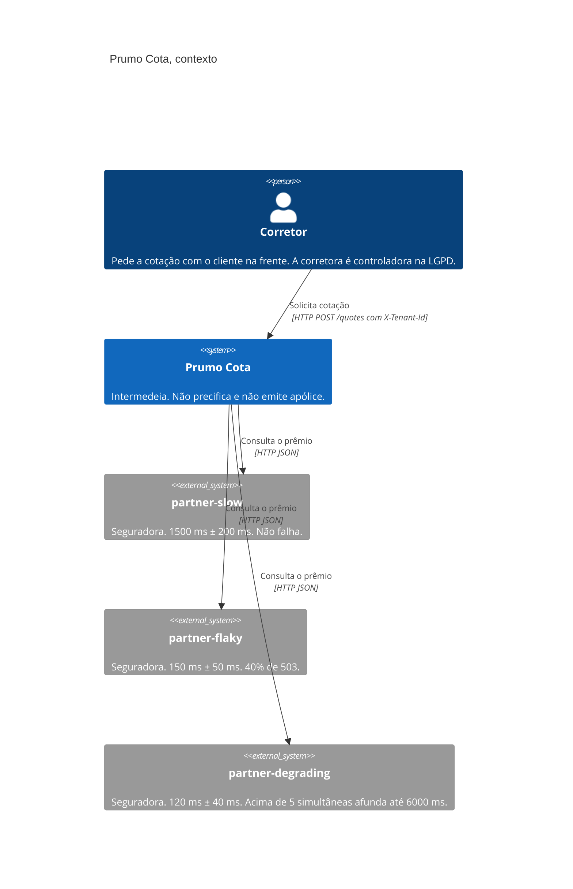
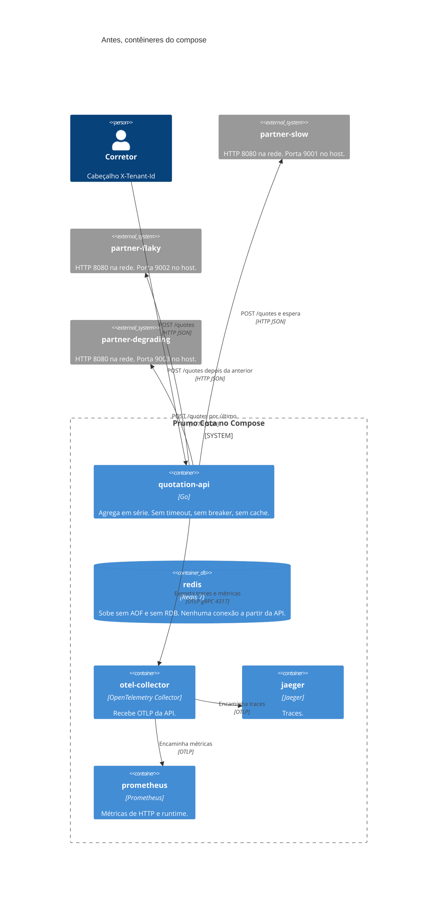
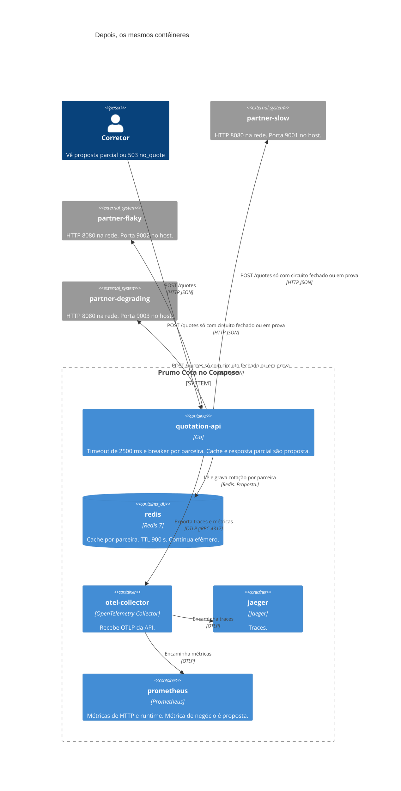
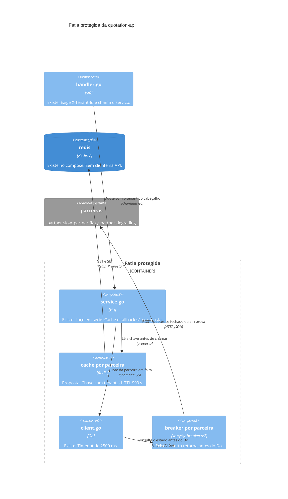

# SAD — Prumo Cota

Documento de decisão da plataforma de cotação de seguro auto. Três leitores: o CTO, que confere a conta; quem opera de madrugada, que precisa saber o que a corretora está vendo; o encarregado de dados, que responde à ANPD e à SUSEP.

O que está no repositório hoje está escrito como fato, com arquivo. O que esta arquitetura acrescenta e ainda não está no código está marcado como **proposta**.

## 1. Introdução

### Propósito

Este SAD trava como a Prumo Cota deixa de perder a cotação inteira quando uma seguradora falha ou afunda, e quanto isso custa. A Prumo não vende seguro. Vende, para a corretora, a comparação das propostas. A decisão sustentada aqui é a fronteira com as três parceiras: timeout, circuit breaker, cache e fallback.

### Escopo

O documento cobre a plataforma de cotação e a fronteira com as seguradoras. O motor de precificação de cada seguradora fica do lado de lá dessa fronteira. O CRM da corretora fica do lado de cá, fora da plataforma. A Prumo intermedeia. O prêmio só entra na resposta se uma parceira o devolveu ou se o cache ainda aponta a consulta que o originou.

### Restrições

Impostas pelo cenário e pelo repositório, separadas das decisões da seção 4:

- Go 1.25 e o ambiente local em Docker Compose, sem custo de nuvem no PoC.
- Três parceiras, semente `20260729`, no `docker-compose.yml`: `partner-slow` (1500 ms ± 200 ms, não falha), `partner-flaky` (150 ms ± 50 ms, 40% de 503), `partner-degrading` (120 ms ± 40 ms; acima de 5 chamadas simultâneas soma 300 ms por chamada extra, teto 6000 ms, não falha).
- Cobrança de R$ 0,04 por consulta ao motor da seguradora. A corretora paga R$ 0,25 por cotação entregue.
- A corretora vem no cabeçalho `X-Tenant-Id`. CPF, ano de nascimento e placa vêm no corpo. A corretora é controladora; a Prumo é operadora.
- Auditoria SUSEP: toda cotação apresentada, por cinco anos, com seguradora, prêmio, corretora e instante. Vale para cache e para fallback. O arquivo dessa auditoria é **proposta**. O `redis` do compose não é esse arquivo: sobe com `--save ""` e `--appendonly no`.
- Teto comercial do prêmio reaproveitado: 24 h. O `valid_for_seconds` que o mock devolve é 300 s. Esse campo é o TTL técnico do mock.
- A agregação permanece em série. Paralelizar as parceiras é bônus e não faz parte desta decisão. O p95 alvo da seção 3 é a soma, não o máximo.

### Decisões

Estas quatro estão fechadas na seção 4, com os parâmetros que o código vai repetir: circuit breaker por parceira, cache por parceira com TTL de 900 s, fallback de resposta parcial, hospedagem de produção em nuvem no Brasil. O PoC continua no Compose local.

### Pressupostos

1. Sem cache, o mês custa 120.000 cotações por dia útil × 22 dias × 3 consultas × R$ 0,04 = R$ 316.800. A receita é 120.000 × 22 × R$ 0,25 = R$ 660.000. Origem: cenário do enunciado. Se o volume cair pela metade, a economia cai pela metade. A auditoria de cinco anos não diminui com o cache, e a seção 8 pode mudar de veredito.
2. Nesta máquina (Windows 11 Education, Intel Core i5-12450H, Docker Engine 27.4.0, Compose v2.31.0), depois de `make down` e `make reproduce`, a carga entregou 120 de 200 (60%), p95 8,01 s, 8,0 req/s; o baseline entregou 5 de 10 (50%), p95 2,04 s. O trace `251f53502c68ca6036455b872b7e795e` mostra a `partner-degrading` em 6149 ms no fim da cascata. Janela 2026-11-17 22:12:31–22:13:14 UTC. Relatório em `docs/evidencias/antes-reproduce.txt`. Se uma medição nova não repetir esse p95 de carga, a coluna "hoje" da seção 3 fica inválida.
3. Hipótese de recotação, que alimenta o hit rate da seção 8: 40% das cotações da mesma corretora e do mesmo risco se repetem dentro de 900 s. O cenário afirma que o corretor recota na mesma conversa e não dá percentual. A economia correspondente é 0,40 × 316.800 = R$ 126.720 por mês. Se a repetição for 10%, a economia cai para R$ 31.680 por mês e a seção 8 muda de veredito. A mesma placa pedida por outra corretora não entra nesse hit rate: a chave do cache leva o `tenant_id`.

## 2. Visão geral da arquitetura

### Contexto

A corretora pede a cotação. A Prumo Cota consulta três seguradoras e devolve as propostas da mais barata para a mais cara. Nenhuma seta devolve um prêmio calculado pela Prumo.

### Antes

Os nomes são os serviços do `docker-compose.yml`. A `quotation-api` chama as três parceiras em série e espera a próxima. O `http.Client` em `internal/partner/client.go` não tem `Timeout`. Uma falha devolve `Response{}` em `internal/quotation/service.go`, e `internal/quotation/handler.go` responde 502 `partner insurer unavailable`. O `redis` sobe e a API não tem endereço dele. O caminho de telemetria que já existe é `quotation-api` → `otel-collector` → `jaeger` e `prometheus`.

No trace `251f53502c68ca6036455b872b7e795e` a `partner-degrading` leva 6149 ms no fim da cascata. No trace `4feb557ea0aeb06e78eabc953eebfc59` a `partner-flaky` responde 503, o span da `partner-degrading` não existe e a ponta responde 502.

### Depois

Os mesmos oito contêineres. Muda o uso. A `quotation-api` já corta cada parceira com timeout de 2500 ms e um breaker. A leitura do `redis`, o cache e o fallback continuam **proposta**. Nenhum contêiner novo entra neste desenho. O arquivo de auditoria de cinco anos continua **proposta** e não aparece aqui.

### Delta

Acrescenta, em `internal/partner/client.go`:

- timeout de 2500 ms no `http.Client`, e estouro conta como falha do breaker;
- um circuit breaker por parceira.

Ainda **proposta**:

- leitura e escrita no `redis` já existente, chave com a corretora, TTL de 900 s;
- resposta parcial, com `degraded` e `unavailable_partners`, e 503 `no_quote` quando não houver proposta.

Muda de lugar, ainda **proposta**:

- a falha de uma parceira deixa de apagar as propostas já obtidas;
- o `redis` deixa de ser um contêiner ocioso.

Permanece:

- a agregação em série;
- os contêineres `quotation-api`, `partner-slow`, `partner-flaky`, `partner-degrading`, `redis`, `otel-collector`, `jaeger` e `prometheus`;
- o prêmio calculado fora da plataforma.

### A quem esta arquitetura serve

O corretor recebe, no alvo da seção 3, uma comparação em até 2,5 s e enxerga qual seguradora faltou. A Prumo deixa de pagar R$ 0,04 pela consulta que o cache de 900 s absorve: R$ 126.720 por mês no pressuposto de 40%. O encarregado mostra que a corretora A não lê a cotação da corretora B, e que o CPF sai do cache em 900 s. Quem opera vê circuito aberto como ausência de chamada, durante 30 s, e não como um 502 genérico.

## 3. Requisitos funcionais e não funcionais

### Funcionais

RF-01. Sem `X-Tenant-Id` o `POST /quotes` responde 400. Com tenant ausente da configuração responde 403. Nos dois casos nenhuma parceira é chamada. Hoje isso está em `internal/quotation/handler.go`.

RF-02. Cada prêmio da resposta vem de uma parceira ou de uma entrada de cache que aponta a consulta de origem (`partner` e `quote_id`). A lista volta ordenada por `premium_cents` crescente. A plataforma não calcula prêmio.

RF-03. Toda cotação apresentada ao corretor, inclusive a servida de cache ou de fallback, permanece auditável por cinco anos, com seguradora, prêmio, corretora e instante, e aponta a consulta que a originou. O arquivo dessa retenção é **proposta**. O `redis` efêmero não o substitui.

RF-04. **Proposta.** Com o circuito de uma parceira aberto, a `quotation-api` não envia `POST /quotes` a essa parceira. Descartar o corpo depois da chamada não cumpre este requisito.

RF-05. **Proposta.** A segunda cotação da mesma corretora e do mesmo risco, dentro de 900 s, não chama a parceira cuja entrada ainda está no cache. O mesmo corpo com outro `X-Tenant-Id` não reutiliza a entrada.

RF-06. **Proposta.** Se ao menos uma parceira produz prêmio, a resposta é HTTP 200, a ordem por `premium_cents` crescente se mantém, `degraded` é verdadeiro quando faltar alguma e `unavailable_partners` nomeia quem faltou. Se nenhuma produz, a resposta é HTTP 503, corpo `no_quote`, com a lista das parceiras e `retry_after_seconds` 30. Esse corpo é distinto do 502 `partner insurer unavailable`.

### Não funcionais

A coluna "hoje" é a execução de `make reproduce` desta máquina, janela 2026-11-17 22:12:31–22:13:14 UTC, registrada em `docs/evidencias/antes-reproduce.txt`. RNF-01, RNF-02, RNF-03 e RNF-04 saem dessa execução. RNF-05 sai do mesmo intervalo: o trace longo mede 6149 ms na `partner-degrading` porque o cliente não tem timeout.

| ID | Requisito | Métrica | Hoje | Alvo | Como medir | Por que este número |
|---|---|---|---|---|---|---|
| RNF-01 | Latência da cotação sob carga | p95 do `POST /quotes` | 8,01 s | 2,5 s | `make reproduce` e `http_server_request_duration_seconds` | Soma em repouso: 1,50 + 0,15 + 0,12 = 1,77 s, mais margem. O baseline já mediu 2,04 s. |
| RNF-02 | Latência do caminho feliz | p95 do baseline de 10 requisições | 2,04 s | ≤ 2,5 s | `make reproduce` | O caminho feliz já cabe na conversa do corretor. O alvo o preserva. |
| RNF-03 | Entrega sob carga | fração da carga com ao menos uma proposta | 60% (120/200) | ≥ 95% | `make reproduce` | Os 40% de 503 da `partner-flaky` zeram a resposta hoje. A resposta parcial devolve as outras. |
| RNF-04 | Vazão da carga | requisições por segundo concluídas | 8,0 req/s com p95 8,01 s | 8,0 req/s com p95 ≤ 2,5 s | `make reproduce` | A carga oferecida já é 8,0 req/s. O alvo é sustentá-la dentro de RNF-01. |
| RNF-05 | Corte da parceira | timeout do `http.Client` | ilimitado (6149 ms no trace da `partner-degrading`) | 2500 ms, e o estouro conta como falha do breaker | teste do cliente e span da chamada | A `partner-slow` chega a cerca de 1700 ms. Um corte de 1500 ms a derrubaria. Um corte de 6000 ms não veria a `partner-degrading`. |

RNF-01 sob carga depende do breaker da `partner-degrading` já aberto. A primeira leva de chamadas simultâneas ainda espera o timeout de 2500 ms, porque não há limite de concorrência (limite 1 da seção 4). Em série, essa leva custa a `partner-slow` mais 2500 ms e passa de 2,5 s. O alvo permanece 2,5 s para o que vem depois do circuito aberto. A conta desse desenho, em reais, fecha na seção 8.

## 4. Detalhamento da arquitetura

Quatro decisões. Cada parâmetro numérico é o da seção 1 e o da seção 3. A fatia que muda é `internal/partner/client.go` e `internal/quotation/service.go`.

### Circuit breaker

**Contexto.** A `partner-flaky` devolve 503 em 40% das chamadas. Hoje isso vira 502 da plataforma e apaga o que a `partner-slow` e a `partner-degrading` já tinham respondido. A `partner-degrading` não devolve erro: afunda até 6000 ms. Um breaker que só conta HTTP de erro nunca abre para ela. A rajada presa no mock tem 9 falhas consecutivas nas sequências 49 a 57.

**Opções.**

- Um breaker global. A rajada da `partner-flaky` abriria o circuito das três. A corretora perderia também quem está saudável, e a Prumo deixaria de mostrar preço que já poderia ter sido pago.
- Um breaker por par (parceira, corretora). A falha é da seguradora. A corretora A continuaria pagando R$ 0,04 e esperando a `partner-flaky` depois que a corretora B já tinha visto as cinco falhas.
- Um breaker por parceira, com os três estados nomeados no código. A `partner-flaky` aberta não é chamada. As outras duas seguem.

Biblioteca `github.com/sony/gobreaker/v2`, pelos estados `closed`, `open` e `half-open`. Está no `go.mod`. Alternativa descartada: `github.com/afex/hystrix-go`, que não expõe o meio-aberto como estado nomeado.

**Escolha.** Um breaker por parceira, em `internal/partner/client.go`. Abre com 5 falhas consecutivas. A janela é de 60 s: a contagem zera no sucesso e no fim da janela. O circuito fica aberto 30 s. O meio-aberto deixa passar 1 prova. Um sucesso fecha. A falha da prova reabre por mais 30 s. O timeout do cliente é 2500 ms e o estouro conta como falha. Circuito aberto retorna antes de `http.Client.Do`. Na semente `20260729`, a 5ª falha consecutiva é a chamada 42, antes da rajada 49–57. A chamada 43 não chega à parceira e a sequência do mock permanece em 42.

**Consequências ruins.** Com 40% de falha, cinco consecutivas acontecem fora de um apagão longo. A corretora fica até 30 s sem o preço da `partner-flaky` e vê `unavailable_partners`. Três falhas consecutivas abririam cedo demais e esse preço quase sumiria. A primeira leva simultânea, disparada antes da quinta falha completar, ainda espera 2500 ms: o estado aberto só protege a chamada que ainda não saiu. Cada réplica aprende sozinha (limite 2). Reiniciar a API zera os três breakers e volta a pagar a parceira que estava aberta. Quem opera, com o circuito aberto, espera a prova de 30 s. Não trata o aberto como pane da `quotation-api`.

### Cache

**Contexto.** Cada consulta custa R$ 0,04, e o corretor recota o mesmo risco na mesma conversa. O `redis` já está no compose e `internal/platform/config.go` não tem o endereço dele. A mesma placa, para outra corretora, tem preço comercial diferente e é dado de outro controlador.

**Opções.**

- Cache da cotação agregada, uma chave por corretora e risco. Um acerto economiza as três consultas. A falha da `partner-flaky` invalida a entrada inteira e a Prumo volta a pagar a `partner-slow` e a `partner-degrading`.
- Cache por parceira, com a corretora na chave. A parceira aberta não apaga as outras duas. A economia do pressuposto de 40% conta três consultas evitadas só quando as três entradas estão vivas.

**Escolha.** Cache por parceira. Chave, literal:

`quote:{tenant_id}:{partner}:{document}:{birth_year}:{plate}:{model}:{year}:{value_cents}:{coverage}`

O `tenant_id` sai só do cabeçalho `X-Tenant-Id`. Normalização: `document` só com dígitos; `plate` em A-Z0-9 maiúsculo; `model` em maiúsculo com espaços colapsados; `coverage` o enum já validado (`comprehensive` ou `third_party`). TTL de 900 s. O teto comercial é 24 h. Os 900 s cobrem a conversa do corretor e fazem o CPF sair do Redis nesse prazo. O `valid_for_seconds` de 300 s do mock não define esse TTL. Amarrar o cache a 300 s deixaria o hit rate de 40% sem fundamento.

Com o breaker aberto, a entrada dentro dos 900 s é servida e a parceira não é chamada. A entrada vencida não é servida: a parceira entra em `unavailable_partners` e as outras seguem. Não há invalidação antes do TTL. O valor guardado traz `partner` e `quote_id` da consulta de origem, para a auditoria do RF-03. A ligação com o Redis nasce em `internal/quotation/service.go` (**proposta**). O cliente Redis não está no `go.mod`.

**Consequências ruins.** O preço pode mudar na seguradora antes de 900 s, e a corretora continua vendo o prêmio antigo até o TTL (limite 3). Um pedido de exclusão do titular espera esse prazo. O Redis sem AOF perde o cache no restart: a seção 7 trata o custo de comprar de novo as consultas, e a `partner-degrading` recebe o volume de uma vez. Duas requisições simultâneas da mesma chave, uma já gravada e outra ainda na parceira, podem devolver prêmios diferentes. A chave carrega CPF. Métrica e span não carregam CPF, placa nem `quote_id`. O `tenant_id` pode.

### Fallback

**Contexto.** Hoje, `service.go` devolve `Response{}` no primeiro erro e o handler responde 502 `partner insurer unavailable`. Na carga medida, 80 das 200 requisições terminaram assim, depois de a plataforma já ter pago pelo menos a `partner-slow`.

**Opções.**

- Cotação anterior do cache, marcada, com a idade. A primeira falha do dia não tem o que servir. O corretor fica sem proposta justamente quando ainda não existe histórico.
- Recusa explícita em toda falha, com status próprio. O corretor sabe que deve tentar de novo e a plataforma continua jogando fora o prêmio que já comprou. O sucesso permanece perto dos 60% medidos, e o RNF-03 não se alcança.
- Resposta parcial, nomeando quem faltou, com a ordem por prêmio crescente. O corretor segue a venda com quem respondeu.

**Escolha.** Resposta parcial, em `internal/quotation/service.go` e no `Response` de `internal/quotation/request.go` (**proposta**). HTTP 200 se houver ao menos uma proposta. Campos novos: `degraded` (bool) e `unavailable_partners` (lista dos nomes `partner-slow`, `partner-flaky`, `partner-degrading`). A ordem por `premium_cents` crescente se mantém. Sem nenhuma proposta: HTTP 503, corpo `no_quote`, a lista das três parceiras e `retry_after_seconds` 30, igual ao tempo aberto do breaker. Esse corpo substitui, nesse caso, o 502 `partner insurer unavailable`. Prêmio inventado não entra.

**Consequências ruins.** A corretora pode fechar o seguro sem a seguradora que faltou. A comparação está incompleta, e o campo `degraded` é o que impede ler isso como sucesso pleno. O 503 `no_quote` ainda acontece quando as três estão abertas e o cache das três venceu: a corretora espera 30 s e tenta de novo. Log de fallback, sozinho, não cumpre o RF-06.

### Hospedagem

**Contexto.** A cotação carrega CPF. A auditoria SUSEP fica cinco anos e não é regravável. A Prumo é operadora. O PoC deste repositório é o Compose local, de custo zero, e assim permanece. A decisão abaixo é onde a produção roda. O volume do cenário é 120.000 cotações por dia útil. O pico medido nesta máquina foi 8,0 req/s.

**Opções.**

- Nuvem fora do Brasil. O preço de instância tende a ser menor. CPF e o arquivo de cinco anos atravessam fronteira, e a transferência internacional exige mecanismo perante a ANPD. Um incidente nesse arquivo é notificável.
- On-premise no Brasil. A residência fica sob controle da Prumo. O pico de 8,0 req/s e a média do cenário não pagam datacenter, e o acervo de auditoria cresce todo mês durante cinco anos em disco que a Prumo teria de operar, inclusive num segundo site.
- Nuvem com região no Brasil. A residência do CPF e da auditoria fica no país. O storage cresce com a cotação apresentada, não com a consulta evitada pelo cache. A conta desse storage fecha na seção 8.

**Escolha.** Nuvem com região no Brasil para a produção. O PoC permanece no Compose deste repositório, sem custo e sem conta em provedor. Nenhum contêiner de nuvem entra no diagrama da seção 2.

**Consequências ruins.** A região única concentra a perda de site que a seção 7 vai tratar. O cache em Redis continua efêmero no PoC; em produção, persistir o Redis alongaria a vida do CPF além dos 900 s e contradiz o descarte da seção de cache. A auditoria de cinco anos é outro armazenamento, **proposta**, na mesma região, e não o cache.

### Fatia protegida

O desenho cobre `internal/quotation/service.go` e `internal/partner/client.go`. O `handler.go` fica fora da fatia: ele já exige o cabeçalho e passa o tenant. O timeout e o breaker estão em `client.go`. O cache ainda não existe no código.

O caminho de uma cotação, quando o código alcançar esta decisão: o serviço monta a chave com o tenant do cabeçalho; entrada dentro de 900 s volta sem chamada; falta de entrada passa pelo breaker; estado aberto não chama e o nome da parceira vai para `unavailable_partners`; estado fechado ou a prova do meio-aberto chama, com timeout de 2500 ms; sucesso grava a entrada com `partner` e `quote_id`; as propostas obtidas voltam ordenadas por `premium_cents`.

### Limites que esta entrega não resolve

1. Não há limite de chamadas simultâneas por parceira. Gatilho: mais de 5 chamadas ao mesmo tempo na `partner-degrading`. Efeito: ela afunda até o timeout de 2500 ms, o breaker dela abre, e toda corretora perde esse preço por 30 s.
2. O breaker vive na memória do processo. Cada réplica aprende sozinha. Gatilho: duas réplicas e só uma viu as 5 falhas. Efeito: a outra continua chamando, e a corretora que cair nela espera o timeout. No PoC há uma réplica.
3. O TTL é a única invalidação do cache. Gatilho: a seguradora muda o prêmio antes de 900 s, ou o titular pede exclusão. Efeito: a corretora vê o prêmio antigo até o TTL, e a exclusão não é imediata. A janela de CPF no cache é 900 s.
4. Uma corretora pode consumir a capacidade das outras. Gatilho: um tenant sustenta as 50 chamadas em voo da carga. Efeito: a `partner-degrading` afunda para todos os tenants, o p95 deles vai ao timeout e o breaker abre para todo mundo.

O alerta com limiar e o runbook desse circuito aberto fecham na seção 6. O custo do Redis perdido e da parceira fora por seis horas fecha na seção 7. Os R$ 126.720 por mês do pressuposto 3 fecham na seção 8, junto com o armazenamento de auditoria que o cache não reduz.

## 5. Implementação

Fecha depois da evidência do PoC.

## 6. Operação e gestão de mudanças

Fecha depois da evidência do PoC.

## 7. Recuperação de desastres

Fecha depois da evidência do PoC.

## 8. Tecnologias, custos e pessoal (TCO)

Fecha depois da evidência do PoC.
