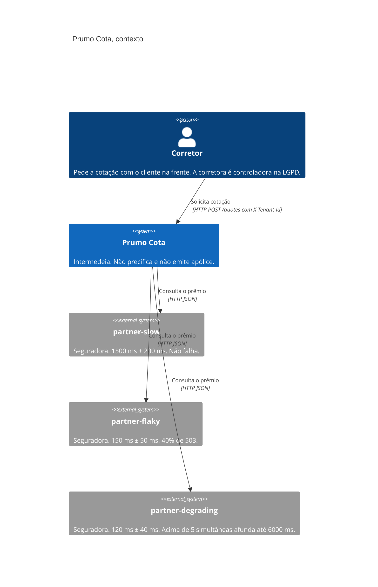
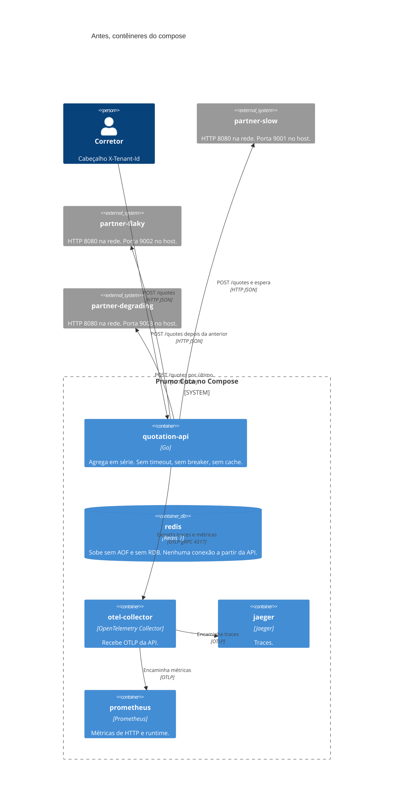
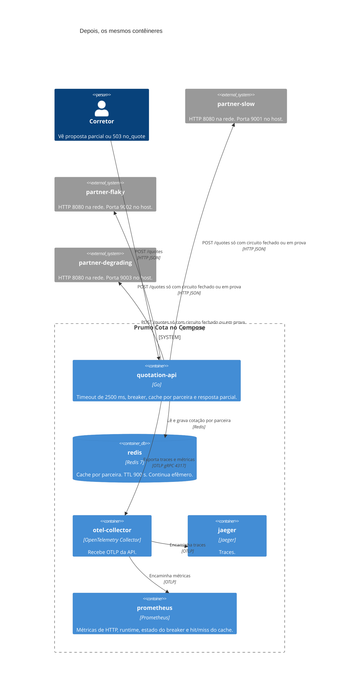
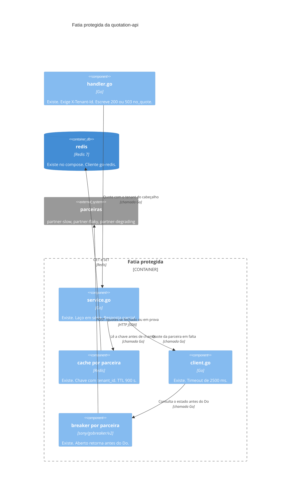

# SAD — Prumo Cota

Documento de decisão da plataforma de cotação de seguro auto. Três leitores: o CTO, que confere a conta; quem opera de madrugada, que precisa saber o que a corretora está vendo; o encarregado de dados, que responde à ANPD e à SUSEP.

O que está no repositório hoje está escrito como fato, com arquivo. O que esta arquitetura acrescenta e ainda não está no código está marcado como **proposta**.

## 1. Introdução

### Propósito

Este SAD trava como a Prumo Cota deixa de perder a cotação inteira quando uma seguradora falha ou afunda, e quanto isso custa. A Prumo não vende seguro. Vende, para a corretora, a comparação das propostas. A decisão sustentada aqui é a fronteira com as três parceiras: timeout, circuit breaker, cache e fallback.

### Escopo

O documento cobre a plataforma de cotação e a fronteira com as seguradoras. O motor de precificação de cada seguradora fica do lado de lá dessa fronteira. O CRM da corretora fica do lado de cá, fora da plataforma. A Prumo intermedeia. O prêmio só entra na resposta se uma parceira o devolveu ou se o cache ainda aponta a consulta que o originou.

### Restrições

Impostas pelo cenário e pelo repositório, separadas das decisões da seção 4:

- Go 1.25 e o ambiente local em Docker Compose, sem custo de nuvem no PoC.
- Três parceiras, semente `20260729`, no `docker-compose.yml`: `partner-slow` (1500 ms ± 200 ms, não falha), `partner-flaky` (150 ms ± 50 ms, 40% de 503), `partner-degrading` (120 ms ± 40 ms; acima de 5 chamadas simultâneas soma 300 ms por chamada extra, teto 6000 ms, não falha).
- Cobrança de R$ 0,04 por consulta ao motor da seguradora. A corretora paga R$ 0,25 por cotação entregue.
- A corretora vem no cabeçalho `X-Tenant-Id`. CPF, ano de nascimento e placa vêm no corpo. A corretora é controladora; a Prumo é operadora.
- Auditoria SUSEP: toda cotação apresentada, por cinco anos, com seguradora, prêmio, corretora e instante. Vale para cache e para fallback. O arquivo dessa auditoria é **proposta**. O `redis` do compose não é esse arquivo: sobe com `--save ""` e `--appendonly no`.
- Teto comercial do prêmio reaproveitado: 24 h. O `valid_for_seconds` que o mock devolve é 300 s. Esse campo é o TTL técnico do mock.
- A agregação permanece em série. Paralelizar as parceiras é bônus e não faz parte desta decisão. O p95 alvo da seção 3 é a soma, não o máximo.

### Decisões

Estas quatro estão fechadas na seção 4, com os parâmetros que o código repete: circuit breaker por parceira, cache por parceira com TTL de 900 s, fallback de resposta parcial, hospedagem de produção em nuvem no Brasil. O PoC continua no Compose local.

### Pressupostos

1. Sem cache, o mês custa 120.000 cotações por dia útil × 22 dias × 3 consultas × R$ 0,04 = R$ 316.800. A receita é 120.000 × 22 × R$ 0,25 = R$ 660.000. Origem: cenário do enunciado. Se o volume cair pela metade, a economia cai pela metade. A auditoria de cinco anos não diminui com o cache. Na conta da seção 8 esse acervo, no ano 5, fica em dezenas de reais por mês e não decide o veredito. O veredito muda se o custo fixo mensal ficar entre a economia cheia e a economia pela metade.
2. Nesta máquina (Windows 11 Education, Intel Core i5-12450H, Docker Engine 27.4.0, Compose v2.31.0), depois de `make down` e `make reproduce`, a carga entregou 120 de 200 (60%), p95 8,01 s, 8,0 req/s; o baseline entregou 5 de 10 (50%), p95 2,04 s. O trace `251f53502c68ca6036455b872b7e795e` mostra a `partner-degrading` em 6149 ms no fim da cascata. Janela 2026-11-17 22:12:31–22:13:14 UTC. Relatório em `docs/evidencias/antes-reproduce.txt`. Se uma medição nova não repetir esse p95 de carga, a coluna "hoje" da seção 3 fica inválida.
3. Hipótese de recotação, que alimenta o hit rate da seção 8: 40% das cotações da mesma corretora e do mesmo risco se repetem dentro de 900 s. O cenário afirma que o corretor recota na mesma conversa e não dá percentual. A economia correspondente é 0,40 × 316.800 = R$ 126.720 por mês. Se a repetição for 10%, a economia cai para R$ 31.680 por mês. O TTL de 900 s sustenta os dois percentuais, e a seção 8 leva as duas linhas. Com o custo fixo defendido lá, as duas se pagam. O veredito fica negativo quando o custo fixo mensal passa da economia: R$ 31.680 no caso de 10%, R$ 126.720 no caso de 40%. A mesma placa pedida por outra corretora não entra nesse hit rate: a chave do cache leva o `tenant_id`.

## 2. Visão geral da arquitetura

### Contexto

A corretora pede a cotação. A Prumo Cota consulta três seguradoras e devolve as propostas da mais barata para a mais cara. Nenhuma seta devolve um prêmio calculado pela Prumo.



### Antes

Os nomes são os serviços do `docker-compose.yml`. A `quotation-api` chama as três parceiras em série e espera a próxima. O `http.Client` em `internal/partner/client.go` não tem `Timeout`. Uma falha devolve `Response{}` em `internal/quotation/service.go`, e `internal/quotation/handler.go` responde 502 `partner insurer unavailable`. O `redis` sobe e a API não tem endereço dele. O caminho de telemetria que já existe é `quotation-api` → `otel-collector` → `jaeger` e `prometheus`.



No trace `251f53502c68ca6036455b872b7e795e` a `partner-degrading` leva 6149 ms no fim da cascata. No trace `4feb557ea0aeb06e78eabc953eebfc59` a `partner-flaky` responde 503, o span da `partner-degrading` não existe e a ponta responde 502.

### Depois

Os mesmos oito contêineres. Muda o uso. A `quotation-api` corta cada parceira com timeout de 2500 ms e um breaker, lê e grava o cache por parceira no `redis` e devolve resposta parcial. Nenhum contêiner novo entra neste desenho. O arquivo de auditoria de cinco anos continua **proposta** e não aparece aqui.



### Delta

Acrescenta, em `internal/partner/client.go`:

- timeout de 2500 ms no `http.Client`, e estouro conta como falha do breaker;
- um circuit breaker por parceira.

Acrescenta, em `internal/quotation/service.go`, `internal/quotation/cache.go`, `internal/quotation/request.go` e `internal/quotation/handler.go`:

- cache por parceira no `redis` já existente, chave com a corretora, TTL de 900 s;
- resposta parcial: HTTP 200 com `degraded` e `unavailable_partners` quando falta alguma parceira;
- HTTP 503 `no_quote`, com `unavailable_partners` e `retry_after_seconds` 30, quando não há proposta.

Muda de lugar:

- a falha de uma parceira deixa de apagar as propostas já obtidas;
- o `redis` deixa de ser um contêiner ocioso.

Permanece:

- a agregação em série;
- os contêineres `quotation-api`, `partner-slow`, `partner-flaky`, `partner-degrading`, `redis`, `otel-collector`, `jaeger` e `prometheus`;
- o prêmio calculado fora da plataforma.

### A quem esta arquitetura serve

O corretor recebe, no alvo da seção 3, uma comparação em até 2,5 s e enxerga qual seguradora faltou. A Prumo deixa de pagar R$ 0,04 pela consulta que o cache de 900 s absorve: R$ 126.720 por mês no pressuposto de 40%. O encarregado mostra que a corretora A não lê a cotação da corretora B, e que o CPF sai do cache em 900 s. Quem opera vê circuito aberto como ausência de chamada, durante 30 s, e não como um 502 genérico.

## 3. Requisitos funcionais e não funcionais

### Funcionais

RF-01. Sem `X-Tenant-Id` o `POST /quotes` responde 400. Com tenant ausente da configuração responde 403. Nos dois casos nenhuma parceira é chamada. Hoje isso está em `internal/quotation/handler.go`.

RF-02. Cada prêmio da resposta vem de uma parceira ou de uma entrada de cache que aponta a consulta de origem (`partner` e `quote_id`). A lista volta ordenada por `premium_cents` crescente. A plataforma não calcula prêmio.

RF-03. Toda cotação apresentada ao corretor, inclusive a servida de cache ou de fallback, permanece auditável por cinco anos, com seguradora, prêmio, corretora e instante, e aponta a consulta que a originou. O arquivo dessa retenção é **proposta**. O `redis` efêmero não o substitui.

RF-04. Com o circuito de uma parceira aberto, a `quotation-api` não envia `POST /quotes` a essa parceira. Descartar o corpo depois da chamada não cumpre este requisito. Hoje isso está em `internal/partner/client.go`.

RF-05. A segunda cotação da mesma corretora e do mesmo risco, dentro de 900 s, não chama a parceira cuja entrada ainda está no cache. O mesmo corpo com outro `X-Tenant-Id` não reutiliza a entrada. Hoje isso está em `internal/quotation/cache.go` e `internal/quotation/service.go`.

RF-06. Se ao menos uma parceira produz prêmio, a resposta é HTTP 200, a ordem por `premium_cents` crescente se mantém, `degraded` é verdadeiro quando faltar alguma e `unavailable_partners` nomeia quem faltou. Se nenhuma produz, a resposta é HTTP 503, corpo `no_quote`, com a lista das parceiras e `retry_after_seconds` 30. Esse corpo é distinto do 502 `partner insurer unavailable`. Hoje isso está em `internal/quotation/request.go`, `internal/quotation/service.go` e `internal/quotation/handler.go`.

### Não funcionais

A coluna "hoje" é a execução de `make reproduce` desta máquina, janela 2026-11-17 22:12:31–22:13:14 UTC, registrada em `docs/evidencias/antes-reproduce.txt`. RNF-01, RNF-02, RNF-03 e RNF-04 saem dessa execução. RNF-05 sai do mesmo intervalo: o trace longo mede 6149 ms na `partner-degrading` porque o cliente não tem timeout.

| ID | Requisito | Métrica | Hoje | Alvo | Como medir | Por que este número |
|---|---|---|---|---|---|---|
| RNF-01 | Latência da cotação sob carga | p95 do `POST /quotes` | 8,01 s | 2,5 s | `make reproduce` e `http_server_request_duration_seconds` | Soma em repouso: 1,50 + 0,15 + 0,12 = 1,77 s, mais margem. O baseline já mediu 2,04 s. |
| RNF-02 | Latência do caminho feliz | p95 do baseline de 10 requisições | 2,04 s | ≤ 2,5 s | `make reproduce` | O caminho feliz já cabe na conversa do corretor. O alvo o preserva. |
| RNF-03 | Entrega sob carga | fração da carga com ao menos uma proposta | 60% (120/200) | ≥ 95% | `make reproduce` | Os 40% de 503 da `partner-flaky` zeram a resposta hoje. A resposta parcial devolve as outras. |
| RNF-04 | Vazão da carga | requisições por segundo concluídas | 8,0 req/s com p95 8,01 s | 8,0 req/s com p95 ≤ 2,5 s | `make reproduce` | A carga oferecida já é 8,0 req/s. O alvo é sustentá-la dentro de RNF-01. |
| RNF-05 | Corte da parceira | timeout do `http.Client` | ilimitado (6149 ms no trace da `partner-degrading`) | 2500 ms, e o estouro conta como falha do breaker | teste do cliente e span da chamada | A `partner-slow` chega a cerca de 1700 ms. Um corte de 1500 ms a derrubaria. Um corte de 6000 ms não veria a `partner-degrading`. |

A medição do depois, nesta mesma máquina, está em `docs/evidencias/depois-reproduce.txt`. Comando: `make down` e em seguida `make reproduce`. Carga de 2026-11-23 02:14:14–02:14:25 UTC: 200 de 200 (100%), p95 243 ms, 579,5 req/s. Baseline: 10 de 10, p95 2,04 s. O `histogram_quantile` do `POST /quotes`, na consulta da seção 6, ficou entre 0,331 s e 0,343 s de 02:14:40 a 02:15:30 UTC (`docs/evidencias/depois-p95.txt`). Os alvos de 2,5 s, de 95% e de 8,0 req/s foram cumpridos. O breaker não abriu nessa carga: o cache absorveu a repetição das 5 cotações, e a `partner-degrading` não produziu 5 estouros consecutivos. A expectativa de que o RNF-01 sob carga dependesse do breaker dela já aberto não se sustenta nessa execução. A prova de que o breaker abre é a sequência de 40 `POST` registrada em `docs/evidencias/depois.md`. O limite 1 da seção 4 permanece: uma rajada com mais de 5 chamadas simultâneas na `partner-degrading`, sem entrada viva no cache, ainda espera o timeout de 2500 ms antes de o circuito abrir. A conta em reais fecha na seção 8.

## 4. Detalhamento da arquitetura

Quatro decisões. Cada parâmetro numérico é o da seção 1 e o da seção 3. A fatia que muda é `internal/partner/client.go` e `internal/quotation/service.go`.

### Circuit breaker

**Contexto.** A `partner-flaky` devolve 503 em 40% das chamadas. Hoje isso vira 502 da plataforma e apaga o que a `partner-slow` e a `partner-degrading` já tinham respondido. A `partner-degrading` não devolve erro: afunda até 6000 ms. Um breaker que só conta HTTP de erro nunca abre para ela. A rajada presa no mock tem 9 falhas consecutivas nas sequências 49 a 57.

**Opções.**

- Um breaker global. A rajada da `partner-flaky` abriria o circuito das três. A corretora perderia também quem está saudável, e a Prumo deixaria de mostrar preço que já poderia ter sido pago.
- Um breaker por par (parceira, corretora). A falha é da seguradora. A corretora A continuaria pagando R$ 0,04 e esperando a `partner-flaky` depois que a corretora B já tinha visto as cinco falhas.
- Um breaker por parceira, com os três estados nomeados no código. A `partner-flaky` aberta não é chamada. As outras duas seguem.

Biblioteca `github.com/sony/gobreaker/v2`, pelos estados `closed`, `open` e `half-open`. Está no `go.mod`. Alternativa descartada: `github.com/afex/hystrix-go`, que não expõe o meio-aberto como estado nomeado.

**Escolha.** Um breaker por parceira, em `internal/partner/client.go`. Abre com 5 falhas consecutivas. A janela é de 60 s: a contagem zera no sucesso e no fim da janela. O circuito fica aberto 30 s. O meio-aberto deixa passar 1 prova. Um sucesso fecha. A falha da prova reabre por mais 30 s. O timeout do cliente é 2500 ms e o estouro conta como falha. Circuito aberto retorna antes de `http.Client.Do`. Na semente `20260729`, a 5ª falha consecutiva é a chamada 42, antes da rajada 49–57. A chamada 43 não chega à parceira e a sequência do mock permanece em 42.

**Consequências ruins.** Com 40% de falha, cinco consecutivas acontecem fora de um apagão longo. A corretora fica até 30 s sem o preço da `partner-flaky` e vê `unavailable_partners`. Três falhas consecutivas abririam cedo demais e esse preço quase sumiria. A primeira leva simultânea, disparada antes da quinta falha completar, ainda espera 2500 ms: o estado aberto só protege a chamada que ainda não saiu. Cada réplica aprende sozinha (limite 2). Reiniciar a API zera os três breakers e volta a pagar a parceira que estava aberta. Quem opera, com o circuito aberto, espera a prova de 30 s. Não trata o aberto como pane da `quotation-api`.

### Cache

**Contexto.** Cada consulta custa R$ 0,04, e o corretor recota o mesmo risco na mesma conversa. O `redis` já está no compose e `internal/platform/config.go` não tem o endereço dele. A mesma placa, para outra corretora, tem preço comercial diferente e é dado de outro controlador.

**Opções.**

- Cache da cotação agregada, uma chave por corretora e risco. Um acerto economiza as três consultas. A falha da `partner-flaky` invalida a entrada inteira e a Prumo volta a pagar a `partner-slow` e a `partner-degrading`.
- Cache por parceira, com a corretora na chave. A parceira aberta não apaga as outras duas. A economia do pressuposto de 40% conta três consultas evitadas só quando as três entradas estão vivas.

**Escolha.** Cache por parceira. Chave, literal:

`quote:{tenant_id}:{partner}:{document}:{birth_year}:{plate}:{model}:{year}:{value_cents}:{coverage}`

O `tenant_id` sai só do cabeçalho `X-Tenant-Id`. Normalização: `document` só com dígitos; `plate` em A-Z0-9 maiúsculo; `model` em maiúsculo com espaços colapsados; `coverage` o enum já validado (`comprehensive` ou `third_party`). TTL de 900 s. O teto comercial é 24 h. Os 900 s cobrem a conversa do corretor e fazem o CPF sair do Redis nesse prazo. O `valid_for_seconds` de 300 s do mock não define esse TTL. Amarrar o cache a 300 s deixaria o hit rate de 40% sem fundamento.

Com o breaker aberto, a entrada dentro dos 900 s é servida e a parceira não é chamada. A entrada vencida não é servida: a parceira entra em `unavailable_partners` e as outras seguem. Não há invalidação antes do TTL. O valor guardado traz `partner` e `quote_id` da consulta de origem, para a auditoria do RF-03. A ligação com o Redis está em `internal/quotation/cache.go` e `internal/quotation/service.go`. O cliente é `github.com/redis/go-redis/v9`, no `go.mod`.

**Consequências ruins.** O preço pode mudar na seguradora antes de 900 s, e a corretora continua vendo o prêmio antigo até o TTL (limite 3). Um pedido de exclusão do titular espera esse prazo. O Redis sem AOF perde o cache no restart: a seção 7 trata o custo de comprar de novo as consultas, e a `partner-degrading` recebe o volume de uma vez. Duas requisições simultâneas da mesma chave, uma já gravada e outra ainda na parceira, podem devolver prêmios diferentes. A chave carrega CPF. Métrica e span não carregam CPF, placa nem `quote_id`. O `tenant_id` pode.

### Fallback

**Contexto.** Hoje, `service.go` devolve `Response{}` no primeiro erro e o handler responde 502 `partner insurer unavailable`. Na carga medida, 80 das 200 requisições terminaram assim, depois de a plataforma já ter pago pelo menos a `partner-slow`.

**Opções.**

- Cotação anterior do cache, marcada, com a idade. A primeira falha do dia não tem o que servir. O corretor fica sem proposta justamente quando ainda não existe histórico.
- Recusa explícita em toda falha, com status próprio. O corretor sabe que deve tentar de novo e a plataforma continua jogando fora o prêmio que já comprou. O sucesso permanece perto dos 60% medidos, e o RNF-03 não se alcança.
- Resposta parcial, nomeando quem faltou, com a ordem por prêmio crescente. O corretor segue a venda com quem respondeu.

**Escolha.** Resposta parcial, em `internal/quotation/service.go`, no `Response` de `internal/quotation/request.go` e no status escrito por `internal/quotation/handler.go`. HTTP 200 se houver ao menos uma proposta. A ordem por `premium_cents` crescente se mantém. Os campos `degraded` (bool) e `unavailable_partners` (lista) saem sempre. `degraded` é falso e a lista é `[]` quando as três propostas chegam. `unavailable_partners` nomeia quem faltou, na ordem configurada (`partner-slow`, `partner-flaky`, `partner-degrading`), não na ordem de prêmio.

Sem nenhuma proposta o handler responde HTTP 503:

```json
{"error":"no_quote","unavailable_partners":["partner-slow","partner-flaky","partner-degrading"],"retry_after_seconds":30}
```

`retry_after_seconds` é 30, o mesmo tempo aberto do breaker (`BREAKER_OPEN_MS` padrão 30000). Esse corpo substitui, nesse caso, o 502 `partner insurer unavailable`. O texto do 502 permanece em `handler.go` para erro que o serviço não classificou como `no_quote`. As mensagens de `Normalize` não mudam. Prêmio inventado não entra.

| Situação | Status | Corpo |
|---|---|---|
| Ao menos uma proposta, alguma parceira faltando | 200 | `degraded` verdadeiro e `unavailable_partners` com os nomes |
| Nenhuma proposta | 503 | `{"error":"no_quote","unavailable_partners":[...],"retry_after_seconds":30}` |
| Erro não classificado como `no_quote` | 502 | `{"error":"partner insurer unavailable","partner":"..."}` |

**Consequências ruins.** A corretora pode fechar o seguro sem a seguradora que faltou. A comparação está incompleta, e o campo `degraded` é o que impede ler isso como sucesso pleno. O 503 `no_quote` ainda acontece quando as três estão abertas e o cache das três venceu: a corretora espera 30 s e tenta de novo. Log de fallback, sozinho, não cumpre o RF-06.

### Hospedagem

**Contexto.** A cotação carrega CPF. A auditoria SUSEP fica cinco anos e não é regravável. A Prumo é operadora. O PoC deste repositório é o Compose local, de custo zero, e assim permanece. A decisão abaixo é onde a produção roda. O volume do cenário é 120.000 cotações por dia útil. O pico medido nesta máquina foi 8,0 req/s.

**Opções.**

- Nuvem fora do Brasil. O preço de instância tende a ser menor. CPF e o arquivo de cinco anos atravessam fronteira, e a transferência internacional exige mecanismo perante a ANPD. Um incidente nesse arquivo é notificável.
- On-premise no Brasil. A residência fica sob controle da Prumo. O pico de 8,0 req/s e a média do cenário não pagam datacenter, e o acervo de auditoria cresce todo mês durante cinco anos em disco que a Prumo teria de operar, inclusive num segundo site.
- Nuvem com região no Brasil. A residência do CPF e da auditoria fica no país. O storage cresce com a cotação apresentada, não com a consulta evitada pelo cache. A conta desse storage fecha na seção 8.

**Escolha.** Nuvem com região no Brasil para a produção. O PoC permanece no Compose deste repositório, sem custo e sem conta em provedor. Nenhum contêiner de nuvem entra no diagrama da seção 2.

**Consequências ruins.** A região única concentra a perda de site que a seção 7 vai tratar. O cache em Redis continua efêmero no PoC; em produção, persistir o Redis alongaria a vida do CPF além dos 900 s e contradiz o descarte da seção de cache. A auditoria de cinco anos é outro armazenamento, **proposta**, na mesma região, e não o cache.

### Fatia protegida

O desenho cobre `internal/quotation/service.go`, `internal/quotation/cache.go` e `internal/partner/client.go`. O `handler.go` exige o cabeçalho, passa o tenant e escreve o HTTP: 200 com o `Response`, ou 503 `no_quote`. O prêmio não é decidido nele. O timeout e o breaker estão em `client.go`. O cache está em `cache.go`.



O caminho de uma cotação: o serviço monta a chave com o tenant do cabeçalho; entrada dentro de 900 s volta sem chamada; falta de entrada passa pelo breaker; estado aberto não chama e o nome da parceira vai para `unavailable_partners`; estado fechado ou a prova do meio-aberto chama, com timeout de 2500 ms; sucesso grava a entrada com `partner` e `quote_id`; as propostas obtidas voltam ordenadas por `premium_cents`. Se sobrar ao menos uma, a resposta é 200 e `degraded` diz se a lista está incompleta. Se não sobrar nenhuma, a resposta é 503 `no_quote`.

### Limites que esta entrega não resolve

1. Não há limite de chamadas simultâneas por parceira. Gatilho: mais de 5 chamadas ao mesmo tempo na `partner-degrading`. Efeito: ela afunda até o timeout de 2500 ms, o breaker dela abre, e toda corretora perde esse preço por 30 s.
2. O breaker vive na memória do processo. Cada réplica aprende sozinha. Gatilho: duas réplicas e só uma viu as 5 falhas. Efeito: a outra continua chamando, e a corretora que cair nela espera o timeout. No PoC há uma réplica.
3. O TTL é a única invalidação do cache. Gatilho: a seguradora muda o prêmio antes de 900 s, ou o titular pede exclusão. Efeito: a corretora vê o prêmio antigo até o TTL, e a exclusão não é imediata. A janela de CPF no cache é 900 s.
4. Uma corretora pode consumir a capacidade das outras. Gatilho: um tenant sustenta as 50 chamadas em voo da carga. Efeito: a `partner-degrading` afunda para todos os tenants, o p95 deles vai ao timeout e o breaker abre para todo mundo.

O alerta com limiar e o runbook desse circuito aberto fecham na seção 6. O custo do Redis perdido e da parceira fora por seis horas fecha na seção 7. Os R$ 126.720 por mês do pressuposto 3 fecham na seção 8, junto com o armazenamento de auditoria que o cache não reduz.

## 5. Implementação

A medição em `docs/evidencias/` confirmou os números da seção 4. O timeout permanece 2500 ms. Os 30 s abertos aparecem no relógio: a `partner-flaky` foi de `closed` para `open` às 02:19:10 UTC e a prova saiu às 02:19:40 UTC (`docs/evidencias/depois-breaker.txt`). Nenhum limiar da seção 3 ou da seção 4 foi desmentido. A carga padrão não abriu breaker nenhum. A seção 3 registra isso. Os 5 consecutivos permanecem.

### Onde cada mecanismo nasce

| Mecanismo | Arquivo | Parâmetro |
|---|---|---|
| Timeout de 2500 ms no `http.Client`. Estouro conta como falha do breaker. | `internal/partner/client.go` | `PARTNER_TIMEOUT_MS`, padrão 2500, em `internal/platform/config.go` |
| Um breaker por parceira. 5 falhas consecutivas, janela de 60 s, aberto 30 s, 1 prova no meio-aberto. Aberto retorna antes de `http.Client.Do`. | `internal/partner/client.go` | `BREAKER_CONSECUTIVE_FAILURES` 5, `BREAKER_INTERVAL_MS` 60000, `BREAKER_OPEN_MS` 30000, `BREAKER_HALF_OPEN_MAX` 1 |
| Gauge, contador e evento `circuit.short_circuit`. | `internal/partner/observe.go` | nomes na seção 6 |
| Cache por parceira, chave da seção 4, TTL 900 s. Entrada viva é servida com o circuito aberto. Entrada vencida não é servida. | `internal/quotation/cache.go`, `internal/quotation/service.go` | `CACHE_TTL_SECONDS` 900, `REDIS_ADDR` |
| Ping no Redis no boot. Sem Redis o processo não escuta. | `cmd/quotation-api/main.go` | o compose passa `REDIS_ADDR=redis:6379` |
| Hit, miss e evento `cache.hit`. | `internal/quotation/observe.go` | nomes na seção 6 |
| Resposta parcial e 503 `no_quote`. | `internal/quotation/service.go`, `internal/quotation/request.go`, `internal/quotation/handler.go` | `retry_after_seconds` 30, igual a `BREAKER_OPEN_MS` |
| Auditoria de cinco anos. | **proposta**. Não há arquivo no repositório. | o `redis` do compose sobe com `--save ""` e `--appendonly no` |

Biblioteca do breaker: `github.com/sony/gobreaker/v2` v2.4.0, no `go.mod`. Os estados no código são `closed`, `open` e `half-open`. A alternativa `github.com/afex/hystrix-go` fica de fora: ela não expõe o meio-aberto como estado nomeado, e a prova de 30 s precisa desse nome no contador `from_state` / `to_state`. Cliente do Redis: `github.com/redis/go-redis/v9` v9.17.2. O teste de cache usa `github.com/alicebob/miniredis/v2` v2.37.0.

O teste que abre o circuito é `TestOpenCircuitDoesNotAdvanceTheFlakySequence`, em `internal/partner/breaker_test.go`. Ele sobe o `cmd/partner-mock` com a semente `20260729`, `PARTNER_FAILURE_RATE=0.4` e `PARTNER_LATENCY_MS=0`. A 5ª falha consecutiva é a chamada 42. A chamada seguinte não incrementa `X-Partner-Seq`: a sequência permanece em 42. A decisão de abrir não espera relógio da máquina. O `Sleep` de 20 ms nesse arquivo só aguarda o `/healthz` do mock. `TestTimeoutCountsAsBreakerFailure`, no mesmo arquivo, mostra que o estouro entra na contagem. Cache e fallback ficam em `internal/quotation/service_test.go` e `internal/quotation/handler_test.go`, com quoter falso e miniredis, sem rede. `TestOpenCircuitServesTheEntryInsideTheTTL` e `TestExpiredEntryIsNotServedWhenTheCircuitIsOpen` cobrem a escolha da seção 4. `TestQuotesReturnsPartialWhenOneNamedPartnerFails` e `TestQuotesResponds503NoQuoteWhenEveryPartnerFails` cobrem o RF-06.

A prova com o ambiente de pé está em `docs/evidencias/depois.md`, porque a carga padrão não abre o breaker: 40 `POST` sequenciais em `http://localhost:8080/quotes`, `X-Tenant-Id: corretora-b`, um risco novo por chamada, 2026-11-23 02:18:46–02:19:58 UTC. `partner_breaker_state` da `partner-flaky` passa de 0 para 2 às 02:19:10 UTC e segue em 2 até 02:22:30 UTC. Transições: `closed → open` às 02:19:10; `open → half-open` e `half-open → open` às 02:19:40. `partner-slow` e `partner-degrading` permanecem em 0. O trace `99e2e3a474b06db7472daf239464ce31` tem o evento `circuit.short_circuit` da `partner-flaky` e não tem span `HTTP POST` para ela.

### Onde roda

O PoC roda no Compose desta máquina. Custo do PoC: R$ 0. A produção, decidida na seção 4, é nuvem com região no Brasil: uma `quotation-api`, um Redis de 1 GiB e o arquivo de auditoria na mesma região. A quantidade de cada peça e o preço hipotético estão na seção 8.

Nuvem fora do Brasil fica descartada. CPF e a auditoria de cinco anos atravessariam fronteira, e a transferência internacional exige mecanismo perante a ANPD. On-premise no Brasil fica descartado pelo volume: o pico medido foi 8,0 req/s e o mês de parceiras, sem cache, é R$ 316.800. Esse pico não paga um datacenter próprio, e o acervo cresce todo mês durante cinco anos em disco que a Prumo operaria, inclusive num segundo site. A região brasileira única custa as linhas da seção 8 e concentra a perda de região que a seção 7 trata.

## 6. Operação e gestão de mudanças

Quem opera olha três séries. O estado do breaker é o gauge `partner.breaker.state`, atributo `partner`: 0 fechado, 1 meio-aberto, 2 aberto. O contador `partner.breaker.transitions` traz `from_state` e `to_state` (`closed`, `half-open`, `open`). A prova do meio-aberto dura uma chamada, menos que o export de 10 s, e o contador é o que guarda esse passo. O hit e o miss do cache são `quote.cache.hit` e `quote.cache.miss`, atributo `partner`. A latência por parceira reaproveita `http.client.request.duration`, emitida pelo `otelhttp` em `internal/platform/telemetry.go` quando `internal/partner/client.go` chama a seguradora. No Prometheus o nome é `http_client_request_duration_seconds` e a parceira é `server_address`. Cache hit e circuito aberto ficam de fora dessa série: a chamada não sai.

O Collector troca o ponto por sublinhado e acrescenta `_total` nos contadores. As consultas são:

```promql
partner_breaker_state
```

```promql
sum by (partner, from_state, to_state) (partner_breaker_transitions_total)
```

```promql
sum(rate(quote_cache_hit_total[5m]))
/
(
  sum(rate(quote_cache_hit_total[5m]))
  + sum(rate(quote_cache_miss_total[5m]))
)
```

```promql
histogram_quantile(0.95, sum by (server_address, le) (rate(http_client_request_duration_seconds_bucket[1m])))
```

O hit rate da seção 8 continua o pressuposto de 40% da seção 1 e a sensibilidade de 10%, com TTL de 900 s. O gráfico desta série sob a carga padrão fica de fora dessa conta: a carga repete 5 cotações e o acerto beira 98%.

No trace, a chamada que o circuito recusa marca o evento `circuit.short_circuit`, com `partner` e `breaker.state`, e não abre span de saída. A entrada servida dentro do TTL marca `cache.hit`, com `partner` e `tenant_id`. CPF, placa e `quote_id` não entram em atributo.

`deploy/prometheus/prometheus.yml` não tem `rule_files`. As três consultas abaixo são o que o plantonista avalia nas séries que já existem. A regra que pagina sozinha é **proposta**.

**Alerta 1, circuito aberto.** Consulta:

```promql
avg_over_time(partner_breaker_state[10m]) > 1.5
```

Limiar: média acima de 1,5 no mesmo `partner` por 10 minutos. Um aberto de 30 s, dentro de uma janela de 10 minutos, fica perto de 0,1 e não dispara. Dez minutos em 2, com a prova breve em 1, fica acima de 1,5. Ação: abrir o runbook abaixo quando o `partner` é `partner-degrading`. Para `partner-flaky`, o mesmo limiar vale: vinte provas seguidas em falha deixam de ser o 40% de fundo e passam a ser parceira fora. Não reiniciar a `quotation-api`.

**Alerta 2, cache frio.** Consulta, só quando o denominador é maior que zero:

```promql
sum(rate(quote_cache_hit_total[15m]))
/
(
  sum(rate(quote_cache_hit_total[15m]))
  + sum(rate(quote_cache_miss_total[15m]))
)
< 0.10
```

Limiar: hit rate abaixo de 0,10 por 15 minutos, com tráfego. 0,10 é o piso do pressuposto 3. O gráfico da carga padrão, que beira 98%, não é limiar. Ação: verificar o ping do Redis e se `CACHE_TTL_SECONDS` continua 900. Não aumentar o TTL para perseguir o gráfico. Não executar `FLUSHALL`. Redis mudo com o processo no ar é o cenário (a) da seção 7.

**Alerta 3, parceira afundando.** Consulta:

```promql
histogram_quantile(0.95, sum by (server_address, le) (rate(http_client_request_duration_seconds_bucket[5m]))) > 2
```

Limiar: p95 acima de 2 s no `server_address` da parceira. A `partner-slow` em repouso fica perto de 1,7 s e não dispara. A `partner-degrading` em repouso fica perto de 0,12 s. Acima de 2 s ela já passou de 5 simultâneas e o timeout de 2500 ms está perto. Ação: não subir `PARTNER_TIMEOUT_MS`. Confirmar a rajada do limite 1 da seção 4. Se o p95 passa de 2 s e `partner_breaker_state` segue 0, o estouro não está contando como falha: o defeito está em `internal/partner/client.go`, e alongar a espera até 6000 ms esconde o RNF-05.

### Runbook: breaker da partner-degrading aberto há dez minutos

Sintoma. `partner_breaker_state{partner="partner-degrading"}` sustenta o alerta 1. O contador mostra `closed → open` e, a cada 30 s, `open → half-open` seguido de `half-open → open`. `partner-slow` e `partner-flaky` seguem em 0.

O que a corretora vê. HTTP 200, `degraded` verdadeiro, `unavailable_partners` com `partner-degrading`, e as propostas das outras duas, da parceira ou do cache dentro de 900 s. Ela não vê 502 `partner insurer unavailable`. Ela não espera 6000 ms: com o circuito aberto a chamada não sai.

O que o plantonista faz.

1. Confirma o gauge em 2 e as transições de prova falha. Um restart da API também zera o gauge para 0; se o gauge está 2, o processo não reiniciou.
2. Olha o p95 de `http_client_request_duration_seconds` nesse `server_address`. Prova que chegou a sair fica perto de 2500 ms. A `partner-degrading` não devolve 503: ela afunda, e o estouro é a falha (seção 4, RNF-05).
3. Se o alerta 3 disparou junto, a rajada passou de 5 simultâneas. Não há bulkhead para cortar. No laboratório, parar o gerador de carga tira a rajada. Em produção, o corte de concorrência continua sendo o limite 1, que esta entrega não implementa.
4. Avisa o comercial que a comparação está parcial até o gauge voltar a 0. O preço que falta não é preenchido pela plataforma.

O que o plantonista não faz.

- Não reinicia a `quotation-api` para fechar o breaker. O processo novo nasce com os três circuitos fechados, a próxima leva espera 2500 ms e a quinta falha abre de novo.
- Não sobe `PARTNER_TIMEOUT_MS` para 6000. A parceira continua no teto e o breaker deixa de ver a falha.
- Não dá `FLUSHALL` no Redis. A entrada viva da `partner-degrading` ainda é servida com o circuito aberto, pelo TTL de 900 s (seção 4). Apagar o cache tira o único preço que a corretora ainda tem dela.
- Não chama a parceira por fora da prova, e não inventa prêmio.

Escalonamento. Dez minutos com a prova ainda em falha: acionar o canal da seguradora. Se os três gauges ficam acima do alerta 1, deixa de ser uma parceira. A corretora passa a receber 503 `no_quote` quando o cache das três vence, e o escalonamento é interno, no mesmo instante, além do canal das três seguradoras.

### Mudança do TTL

`CACHE_TTL_SECONDS` é parâmetro de negócio. O padrão 900 está em `internal/platform/config.go`. O teto comercial é 24 h, 86400 s. Acima de 86400 s não há aprovação.

Quem aprova uma mudança dentro do teto: quem responde pelo preço praticável na hora da venda, e o encarregado de dados. O primeiro aceita o prêmio velho até o novo TTL (limite 3 da seção 4). O segundo aceita o CPF na chave do Redis por esse mesmo prazo. Se o novo TTL muda a linha da seção 8, finanças assina a economia que sai. Descer a 300 s, o `valid_for_seconds` do mock, tira o fundamento do hit rate de 40%. Essa descida só segue com a seção 8 recalculada.

Como chega em produção: variável de ambiente do processo `quotation-api`. `parseCache` lê o valor no boot. Não há recarga a quente. Mudar é alterar a variável e reiniciar. No PoC o compose não define `CACHE_TTL_SECONDS`, e vale 900.

Como reverte: a variável volta a 900 e o processo reinicia. A chave já gravada expira no TTL da escrita. `internal/quotation/cache.go` grava com TTL absoluto, e um hit não renova.

Como se mede: a consulta de hit rate desta seção, janela de 15 minutos, comparada com 40% e com 10%. Cada miss de parceira é R$ 0,04 na conta da seção 8. O p95 do `POST /quotes` não é o critério de sucesso do TTL. Um TTL maior baixa o p95 e não prova que o preço ainda vale.

## 7. Recuperação de desastres

Quatro classes. O cache não herda o RPO da auditoria.

| Classe | O que guarda | RPO | RTO |
|---|---|---|---|
| Cache | prêmio por parceira, CPF na chave, TTL 900 s | perda total aceitável. A entrada mais velha já tem 900 s. | Redis vazio aceita escrita na hora. Esquentar de novo leva o tráfego de até 900 s. Não há restore. |
| Breaker | memória do processo | perda total no restart. Os três nascem fechados. | o processo novo sobe fechado. |
| Telemetria | traces e métricas. No compose, Prometheus retém 1 h (`--storage.tsdb.retention.time=1h`). `make down` zera Jaeger, Prometheus e Redis. | no PoC, a última hora. Produção, **proposta**: 7 dias de trace e 15 dias de métrica. | recriar o coletor. A cotação responde sem ele. |
| Auditoria SUSEP | **proposta**. Seguradora, prêmio, corretora, instante e o `quote_id` de origem. Cinco anos, sem regravar. Cotação servida de cache entra. | 0 para o registro já aceito. Sem a segunda cópia deste cenário, a perda da região perde o acervo. | a leitura espera. A escrita não: a proposta de produção recusa a cotação quando o arquivo não aceita o registro. O PoC não faz isso. A cotação sai sem o arquivo. |

A hora usada nos três cenários é hipótese desta seção. O cenário não informa o horário do dia. As 120.000 cotações cabem aqui em 8 h, 15.000 por hora. Se o dia for mais longo, a hora fica mais barata e o mês da seção 8 não muda.

### Redis perdido

O processo que já escuta trata erro de `Get` como miss, em `internal/quotation/cache.go`, e segue. `Set` que falha é ignorado. A corretora continua em HTTP 200. Degrada o atalho de 900 s: o p95 volta para a soma das parceiras e cada consulta é comprada de novo. Não para nada, enquanto o processo não reinicia. Se o processo reinicia com o Redis fora, `cmd/quotation-api/main.go` encerra no ping e a corretora fica sem plataforma. Reiniciar para consertar o cache transforma a degradação em parada. O runbook da seção 6 recusa esse restart.

Cem por cento das consultas voltam a ser compradas. No plano de 40%, o gasto sai de 60% para 100% das 7.920.000 consultas do mês. O extra é R$ 126.720 no mês, R$ 5.760 no dia útil e R$ 720 na hora.

O outro efeito é a `partner-degrading`, que afunda acima de 5 chamadas simultâneas até 6000 ms. No pico medido de 8,0 req/s, em série e com ela em repouso a 120 ms, perder o cache multiplica as chamadas por 1,67 e ela continua perto de 1 em voo. Nesse pico o efeito que chega primeiro é o dinheiro: a consulta que era hit passa a custar R$ 0,04 na hora, e o teto de 6000 ms não chega. O fator 1,67 é o deste pressuposto. O volume às parceiras mais que dobra a partir de 50% de acerto. Não é o caso dos 40%.

O teto chega quando já existem mais de 5 chamadas simultâneas nela. É o limite 1 da seção 4, e é a concorrência de 50 em voo do `make reproduce`. Aí o efeito que a corretora vê primeiro é a latência, no mesmo segundo. A parceira vai em direção aos 6000 ms. O cliente corta em 2500 ms, cinco estouros abrem o breaker por 30 s, e a resposta sai HTTP 200 com `degraded` e `partner-degrading` em `unavailable_partners`. A corretora não espera os 6000 ms. A fatura do extra fecha depois.

Caminho de volta: subir o Redis vazio. Entrada velha não se restaura. O processo que ficou no ar volta a gravar, com TTL de 900 s. Se a API caiu no ping, ela só escuta de novo depois que o Redis responde.

### Parceira fora por seis horas

A `partner-degrading` deixa de produzir sucesso. O timeout de 2500 ms conta como falha. Na quinta consecutiva o breaker dela abre. As outras duas seguem, cada uma com o próprio circuito. A corretora vê HTTP 200, `degraded` verdadeiro e o nome dela em `unavailable_partners`, pelo tempo em que as provas de 30 s falharem. Degrada a comparação, que perde um preço. Para a chamada a essa parceira. A cobrança de R$ 0,25 por cotação entregue segue, porque ainda há proposta (RF-06). O 503 `no_quote` entra quando as três estão sem preço e sem cache vivo.

Em 6 h, na hipótese de 15.000 cotações por hora, são 90.000 cotações. A prova é uma chamada a cada 30 s: 720 × R$ 0,04 = R$ 28,80 pagos à parceira fora. As outras duas, no hit rate de 40%, custam 90.000 × 0,60 × 2 × 0,04 = R$ 4.320. O modo degradado custa R$ 4.348,80. As mesmas 6 h com as três parceiras e o mesmo hit rate custariam R$ 6.480. A diferença, R$ 2.131,20, é consulta que o circuito aberto deixou de comprar. A receita dessas 6 h, com a parcial ainda entregue, é 90.000 × R$ 0,25 = R$ 22.500.

Caminho de volta: a prova de 30 s. Um sucesso fecha o breaker (seção 4). Ninguém reinicia a API para forçar o fechado, e ninguém sobe o timeout para 6000 ms. Prova em falha por mais de 10 minutos dispara o alerta 1 e o escalonamento do runbook.

### Perda do site ou da região

A produção da seção 4 é uma região no Brasil. Perdê-la derruba a `quotation-api`, o Redis e, se a única cópia estiver lá, o arquivo de auditoria. As seguradoras continuam: elas não moram nessa região. A corretora vê a plataforma muda. Não vê 503 `no_quote`, porque não há processo para escrevê-lo. Para a cotação inteira e a receita de R$ 0,25. Não há degradação parcial sem a API. Na hipótese de 15.000 cotações por hora, cada hora parada deixa de realizar R$ 3.750 de receita e deixa de gastar R$ 1.080 de parceiras no plano de 40%. A margem que não entra é R$ 2.670 por hora.

RTO da plataforma: **proposta**, o tempo de recriar o serviço a partir deste repositório em outra região brasileira. Não foi medido. Não há réplica quente. O pico de 8,0 req/s que descartou o datacenter próprio também descarta a região dupla ativa. RPO do cache e do breaker: perda total, aceitável. RPO da auditoria: 0 com a segunda cópia, **proposta**, na outra região brasileira, só do arquivo. Sem essa cópia, a perda da região perde o acervo de cinco anos, e o custo deixa de ser a hora parada.

Caminho de volta: subir a API e um Redis vazio na região alternativa, apontar o arquivo para a cópia que sobreviveu, e voltar a cotar. Os breakers nascem fechados. O cache nasce frio, e o primeiro minuto repete o Redis perdido.

## 8. Tecnologias, custos e pessoal (TCO)

A receita mensal é R$ 660.000 (pressuposto 1). As consultas do mês, sem cache, são 120.000 × 22 × 3 = 7.920.000. O hit rate daqui é o da seção 1, com o TTL de 900 s da seção 4. O 0,910 de `docs/evidencias/depois-hitrate.txt` fica de fora. A carga padrão repete 5 cotações e o acerto beira 98%. Esse gráfico prova que o contador mexe. Não é a planilha.

O TTL de 900 s cobre a conversa do pressuposto 3 e não cobre o dia seguinte. Quarenta por cento é o teto que o pressuposto autoriza. Dez por cento é o mesmo pressuposto, com a repetição mais rara, e cabe na mesma janela. Setenta por cento pediria repetição que o pressuposto não afirma, ou um TTL perto das 24 h. A seção 4 recusou esse TTL porque o CPF permaneceria no Redis.

### Parceiras

| Cenário | Hit rate | Consultas compradas no mês | Custo mensal | Economia contra hoje | Economia / receita |
|---|---|---|---|---|---|
| Hoje | 0% | 7.920.000 | R$ 316.800 | R$ 0 | 0% |
| TTL 900 s, pressuposto 3 | 40% | 4.752.000 | R$ 190.080 | R$ 126.720 | 19,2% |
| TTL 900 s, sensibilidade do pressuposto 3 | 10% | 7.128.000 | R$ 285.120 | R$ 31.680 | 4,8% |

O custo das parceiras sobre a receita fica em 48,0% hoje, 28,8% no hit de 40% e 43,2% no hit de 10%.

### Infraestrutura que esta arquitetura acrescenta

O PoC, neste Compose, custa R$ 0. Redis, Jaeger e Prometheus já vinham no repositório. A produção é **proposta**. As quantidades saem do uso. Os preços unitários são hipótese, não fatura de provedor. Se a hipótese de preço dobrar, o veredito abaixo não muda. O teto que mudaria o veredito está no fim desta seção.

Conjunto vivo do cache, na hipótese de 8 h e de 40% de hit: 15.000 cotações por hora × 0,25 h = 3.750 cotações na janela de 900 s. Descontada a repetição, 2.250 riscos × 3 parceiras = 6.750 chaves. A 1 KiB por valor, cerca de 7 MB. Uma instância de 1 GiB. O dobro de chaves continua nessa instância. Por isso é uma, não um cluster.

A auditoria conta cotação apresentada, não consulta comprada. O cache não reduz essa linha: a cotação servida de cache continua apresentada (RF-03). São 2.640.000 cotações por mês × 12 = 31.680.000 por ano. Hipótese de tamanho: 1 KiB por registro, com seguradora, prêmio, corretora, instante e `quote_id` de origem. Ano 1, no 12º mês: 30,2 GiB. Ano 5, no 60º mês, os cinco anos juntos: 151,1 GiB. Hipótese de preço: R$ 0,12 por GiB-mês, uma cópia, região brasileira. Ano 1: 30,2 × 0,12 = R$ 3,62 por mês. Ano 5: 151,1 × 0,12 = R$ 18,13 por mês. A segunda cópia da seção 7 dobra os dois.

Dimensionar o acervo pelas consultas que o cache ainda compra, e guardar só o miss, erra para baixo pelo inverso da taxa de miss. No hit de 40% a miss é 60%, e o fator é 1 / 0,60 = 1,67. O ano 5 cairia para cerca de 90,6 GiB, e 40% das cotações apresentadas ficariam fora do arquivo. Em reais, a R$ 0,12, a diferença cabe em R$ 7 por mês. O buraco é o RF-03. O fator 2,5 vale para 60% de acerto, que não é o hit rate desta seção.

| Peça | Quantidade e por quê | Custo mensal |
|---|---|---|
| Redis de produção | 1 instância de 1 GiB. O conjunto vivo cabe em cerca de 7 MB. | R$ 200, hipótese |
| Retenção de telemetria | **proposta**: 15 dias de métrica e 7 dias de trace, 1 coletor. O compose retém 1 h e não tem volume. | R$ 100, hipótese |
| Auditoria, mês 12 | 30,2 GiB, cotação apresentada | R$ 3,62 |
| Auditoria, mês 60 | 151,1 GiB, cinco anos juntos | R$ 18,13 |
| Segunda cópia da auditoria, mês 60 | os mesmos 151,1 GiB em outra região brasileira | R$ 18,13 |

Soma da hipótese no ano 5, com a segunda cópia, antes do pessoal: 200 + 100 + 18,13 + 18,13 = R$ 336,26 por mês.

### Pessoal

Construir: 1 engenheiro. A fatia deste repositório já está escrita. Não há custo recorrente de construção.

Operar: 1 plantonista compartilhado. O pico medido é 8,0 req/s e o procedimento cabe na seção 6. Hipótese de custo: R$ 4.000 por mês, fração de um salário, sem folha medida. Pessoa dedicada em tempo integral não cabe no mesmo pico que descartou o datacenter na seção 5.

### Veredito

O cache se paga nos dois hit rates que o TTL de 900 s sustenta.

No hit de 40%, a economia é R$ 126.720 por mês. No hit de 10%, R$ 31.680 por mês. O custo recorrente da hipótese no ano 5, com plantão e segunda cópia da auditoria, é R$ 4.000 + R$ 336,26 = R$ 4.336,26 por mês. Os dois deixam folga no primeiro mês. Com hit rate zero a economia é zero: a plataforma volta aos R$ 316.800 e ainda carrega o Redis.

O veredito negativo começa quando o custo fixo mensal passa da economia. No caso de 10%, esse teto é R$ 31.680. No caso de 40%, R$ 126.720. A auditoria de cinco anos não decide. Se o GiB custar cem vezes a hipótese, o mês 60 vai a R$ 1.813 e a folga do hit de 10% continua. Metade do volume corta a economia pela metade, para R$ 63.360 e R$ 15.840. Com este custo fixo o veredito continua positivo. Ele vira negativo, na metade do volume e no hit de 10%, se o custo fixo passar de R$ 15.840 por mês.

### Da seção 3 à seção 8

| Requisito | Mecanismo na seção 4 | Arquivo na seção 5 | Alerta na seção 6 | Cenário na seção 7 | Reais nesta seção |
|---|---|---|---|---|---|
| RF-01 | cabeçalho obrigatório, sem chamada | `internal/quotation/handler.go` | pedido 400 não gera hit nem chamada | não compra consulta | R$ 0 de parceira |
| RF-02 | prêmio só de parceira ou de cache com `quote_id` | `internal/quotation/service.go` | o miss é a consulta comprada | Redis perdido recompra o prêmio | R$ 0,04 por miss |
| RF-03 | auditoria de 5 anos, proposta | sem arquivo | sem métrica de arquivo | perda da região, RPO 0 só com a segunda cópia | R$ 3,62 no mês 12 e R$ 18,13 no mês 60, por cotação apresentada |
| RF-04 | breaker por parceira, aberto não chama | `internal/partner/client.go` | média do estado acima de 1,5 por 10 min | parceira fora 6 h | R$ 28,80 de sondas em 6 h |
| RF-05 | cache de 900 s com `tenant_id` | `internal/quotation/cache.go` | hit rate abaixo de 0,10 por 15 min | Redis perdido | R$ 126.720 por mês no hit de 40% |
| RF-06 | resposta parcial e 503 `no_quote` | `handler.go`, `request.go`, `service.go` | as três gauges em aberto precedem o 503 | parceira 6 h degrada; a região para | R$ 0,25 continua na parcial e para na região |
| RNF-01 a RNF-04 | timeout, cache e parcial. Alvos cumpridos no depois | `client.go` e `service.go` | p95 por parceira acima de 2 s | rajada na `partner-degrading` | o p95 de 243 ms não entra nesta planilha |
| RNF-05 | 2500 ms, estouro é falha | `client.go`, `breaker_test.go` | o mesmo alerta de 2 s | o corte de 2500 ms chega antes dos 6000 ms | a consulta estourada já foi comprada |
